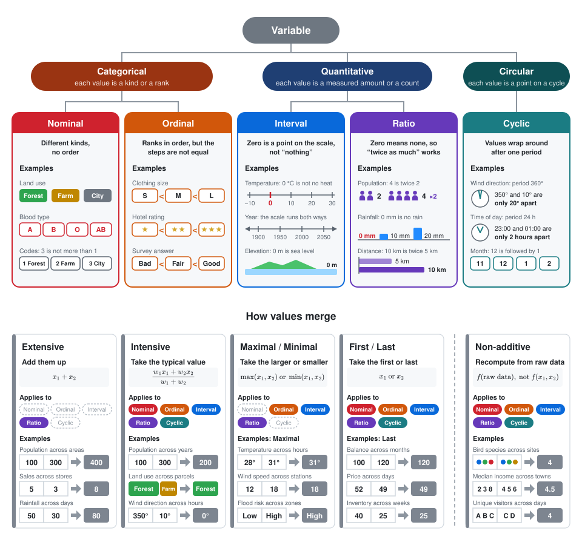

# Variable

## Overview

`variable` defines variables by their measurement properties and tells which operations are meaningful for each one. It is meant for tools that handle attribute data, such as GIS tools, so they can choose how to aggregate, split, and summarize values without guessing. Operations that are not meaningful are reported as warnings and never blocked.

A variable is described along independent axes:

| Axis | Values | Decides |
|---|---|---|
| Measurement level | Nominal, ordinal, interval, ratio, cyclic | Ordering, differences, means, and ratios |
| Combination per dimension | Additivity (extensive, intensive, maximal, minimal, first, last, non-additive) and the weight it needs | Aggregation and disaggregation along each dimension |
| Period | Length of the cycle of a cyclic variable | Wrapping of differences and circular statistics |
| Sign | Whether a ratio variable can be negative | Ratios, geometric means, and coefficients of variation |

Dimensions are space and time by default, and any other breakdown can be defined, such as age groups, depth layers, or monitoring stations.



See [docs/rules.md](docs/rules.md) for the full rules and [src/variable/README.md](src/variable/README.md) for the package contents.

## Installation

Requires Python 3.11+. From the project root:

```bash
pip install -e .
```

## Usage

```python
from variable import (
    AggregationMethod,
    Combination,
    Dimension,
    Operation,
    Variable,
    Weighting,
)

age_group = Dimension(name="age group", is_sized=False, is_ordered=True)

population = Variable.ratio(
    "population",
    is_signed=False,
    combinations={
        Dimension.SPACE: Combination.extensive(Weighting.SIZE),
        Dimension.TIME: Combination.intensive(Weighting.SIZE),
        age_group: Combination.extensive(Weighting.EQUAL),
    },
)
income = Variable.ratio(
    "income",
    is_signed=False,
    combinations={
        Dimension.SPACE: Combination.intensive(population),
        age_group: Combination.intensive(population),
    },
)
hazard_rank = Variable.ordinal(
    "hazard_rank",
    combinations={Dimension.SPACE: Combination.maximal()},
)
wind_direction = Variable.cyclic(
    "wind_direction",
    period=360.0,
    combinations={Dimension.TIME: Combination.intensive(Weighting.SIZE)},
)

print(population.aggregation_method(Dimension.TIME))  # AggregationMethod.WEIGHTED_MEAN
print(income.aggregation_method(age_group))  # AggregationMethod.WEIGHTED_MEAN
print(hazard_rank.aggregation_method(Dimension.SPACE))  # AggregationMethod.MAXIMUM
print(wind_direction.permits(Operation.MEAN))  # False

population.warn_unless_aggregation_permitted(Dimension.TIME, AggregationMethod.SUM)
# MeaninglessOperationWarning: The sum of 'population' over time is not meaningful:
# it is intensive over time, so combined units take the weighted mean.
```
